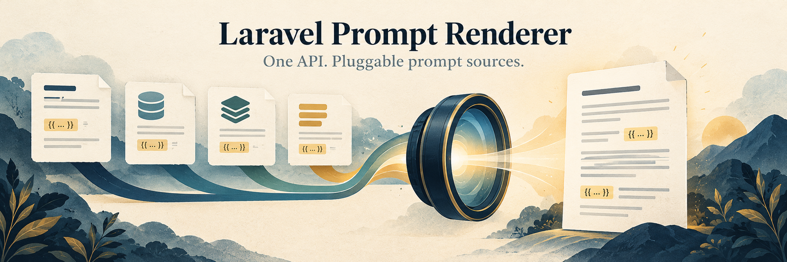

<p align="center"></p>

# Laravel Prompt Renderer

[](https://github.com/eloquage/laravel-prompt-renderer/actions/workflows/run-tests.yml)
[](https://packagist.org/packages/eloquage/laravel-prompt-renderer)
[](LICENSE)

Render Blade prompt templates through one API with Blade, database, cache, stack, or custom sources.

**Requirements:** PHP 8.4+ and Laravel 11, 12, or 13.

## Installation

```bash
composer require eloquage/laravel-prompt-renderer
```

Publish config (optional):

```bash
php artisan vendor:publish --tag=prompt-renderer-config
```

Publish views (optional):

```bash
php artisan vendor:publish --tag=prompt-renderer-views
```

Publish migrations when using the database or cache drivers:

```bash
php artisan vendor:publish --tag=prompt-renderer-migrations
php artisan migrate
```

## Usage

```php
use Eloquage\LaravelPromptRenderer\PromptRenderer;

$prompt = app(PromptRenderer::class)->render('example', [
    'context' => 'document review',
]);
```

Templates are qualified with the configured namespace (`prompts` by default):

- `render('example')` → `prompts.example`
- `render('evidence.ocr-vision')` → `prompts.evidence.ocr-vision`

## Prompt sources

Set the active source via `PROMPT_RENDERER_SOURCE` or `config('prompt-renderer.default_source')`:

| Driver     | Description                                                                      |
|------------|----------------------------------------------------------------------------------|
| `blade`    | Default. Resolves views from app paths, published overrides, then package stubs. |
| `database` | Loads Blade bodies from the `prompt_templates` table.                            |
| `cache`    | Caches template **contents** from an underlying driver (default: `database`).    |
| `stack`    | Tries drivers in `config('prompt-renderer.stack')` order; first match wins.      |

Example stack configuration:

```env
PROMPT_RENDERER_SOURCE=stack
```

```php
'stack' => ['cache', 'database', 'blade'],
```

## Laravel AI SDK

Use rendered prompts as agent instructions:

```php
use Eloquage\LaravelPromptRenderer\PromptRenderer;
use Laravel\Ai\Contracts\Agent;
use Laravel\Ai\Promptable;

class ReviewAgent implements Agent
{
    use Promptable;

    public function __construct(private PromptRenderer $prompts) {}

    public function instructions(): string
    {
        return $this->prompts->render('example', [
            'context' => 'case review',
        ]);
    }
}
```

## Custom drivers

Register custom sources in a service provider:

```php
use Eloquage\LaravelPromptRenderer\Contracts\PromptSource;
use Eloquage\LaravelPromptRenderer\Managers\PromptSourceManager;

PromptSourceManager::extend('redis', fn (): PromptSource => new RedisPromptSource());
```

## Testing

```bash
composer test
composer analyse
composer format
```

## License

MIT.
